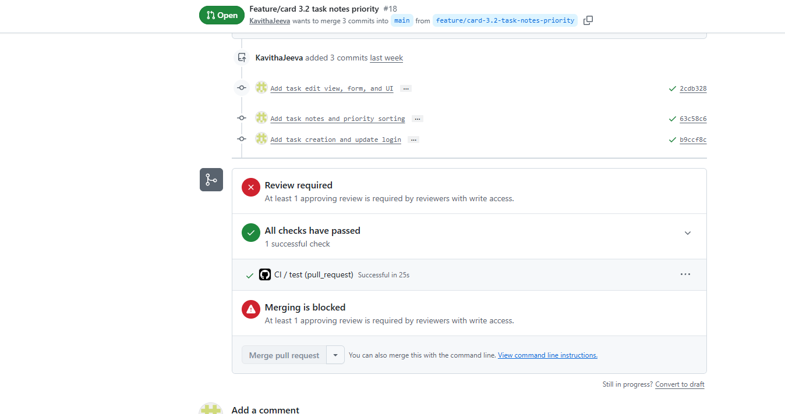

# CSC289 Programming Capstone
## Sprint #3 Review – Individual Contribution

**Project Name:** Task Management System  
**Team Number:** Group 2  
**Team Lead/Scrum Master:** Bethany Arielle Hill  
**Team Member:** Kavitha Jeeva

### 1. My Sprint #3 Contribution

During Sprint #3, I worked on two task cards: **Card 3.2 – Task Notes and Priority Levels** and **Card 3.3 – Edit Task Status**. For Card 3.2, I worked on adding notes and priority levels to tasks, implementing task creation, displaying task details, and allowing users to sort tasks by priority. These features help users organize their tasks and easily identify important work. For Card 3.3, I worked on implementing task editing functionality, including updating task information and changing the task status between To Do, In Progress, and Complete. I also worked on the edit form, view, and URL to save changes to the database and ensure users can only modify their own tasks. In addition, I ran the Django automated test suite to verify the application's functionality, and all 16 tests passed successfully. Through these tasks, I gained practical experience with Django forms, views, database operations, task management functionality, and software testing.

### 2. Demonstration of Completed Features

**Screenshot 1 – Task List**

**Screenshot 2 – Create Task**

**Screenshot 3 – Priority Sorting**

**Screenshot 4 – Edit Task**

### 3. Testing Results

**Result:** All 16 tests passed successfully. No system check issues were reported.

### 3. CI Testing Results

### 4. Summary

I contributed to the development and testing of the Task Management System during Sprint #3. I verified the automated tests and demonstrated the task management features I worked on.