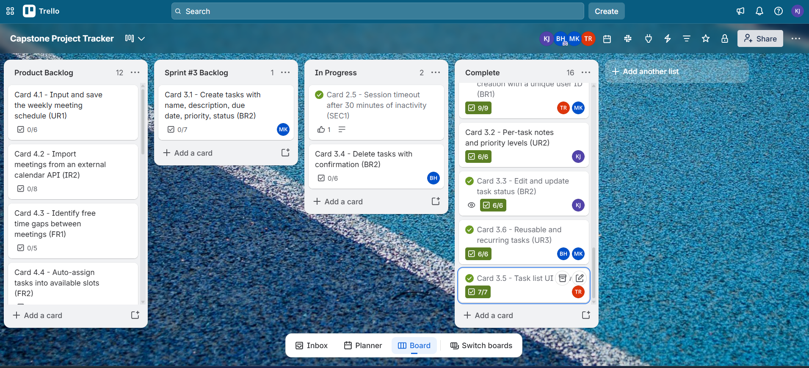

# CSC289 Programming Capstone

## Sprint #3 Status Update 2 – Week 2

**Project Name:** Task Management System  
**Team Number:** Group 2  
**Team Lead/Scrum Master:** Bethany Arielle Hill

## TRELLO BOARD

# STATUS UPDATE DETAILS

## Tasks Scheduled for This Week

Add notes and priority levels to tasks.

Implement task creation and display task details.

Add the ability to sort tasks by priority.

Write and run tests to verify task notes and priority functionality.

## Tasks Completed This Week [by Kavitha Jeeva]

Added a notes field to allow users to save additional information for each task.

Implemented priority levels: High, Medium, and Low.

Updated the task form to support entering and editing notes and priority levels.

Implemented task creation and displayed task notes and priority levels in the task list.

Added sorting functionality to organize tasks by priority.

Ran the Django automated test suite, and all 16 tests passed successfully.

## Problems/Challenges/Roadblocks

**Login test failure – Resolved:** Updated the login test to use the correct form field names and verify the expected error message.

**Task creation page title – Resolved:** Updated the template and view to display the correct title, “Create Task,” when creating a task.