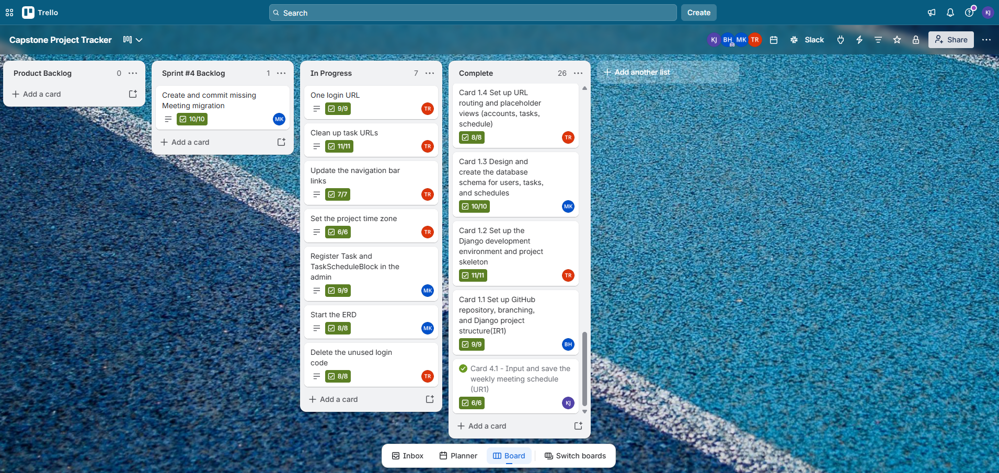

# CSC289 Programming Capstone
## Sprint #4 Review 

**Project Name:** Task Management System  
**Team Number:** Group 2  
**Team Lead/Scrum Master:** Bethany Arielle Hill  
**Team Member:** Kavitha Jeeva

### 1. My Sprint #4 Contribution

During Sprint #4, I worked on **Card 4.1 – Input and Save the Weekly Meeting Schedule (UR1)**.

I worked on implementing the meeting schedule functionality, including creating the Meeting model, developing the meeting form, and updating the views to allow logged-in users to add and save meeting information. I also worked on displaying saved meetings on the Schedule page and associating each meeting with the correct user account.

In addition to my assigned task, I contributed to improving the project's GitHub Actions CI workflow and resolving the requirements.txt file encoding issue. I also reviewed the changes and checked the CI results to make sure the project workflow was functioning correctly.

### 2. Demonstration of Completed Features

**Screenshot 1 – Trello Card 4.1**

**Screenshot 2 – Meeting Model and Form**

**Screenshot 3 – Add Meeting Form**

**Screenshot 4 – Saved Meeting Schedule**

### 3. Testing Results

**Result:** Include the actual test count and result from the latest test run after verifying the completed Card 4.1 functionality.

### 4. CI Testing Results

### 6. Summary

During Sprint #4, I contributed to the development and improvement of the Task Management System by working on the weekly meeting schedule functionality and supporting the project's CI workflow. I also reviewed the code changes and testing results and prepared screenshots to demonstrate my contributions. This sprint helped me gain more practical experience with Django models, forms, views, database operations, GitHub Actions, and software testing.