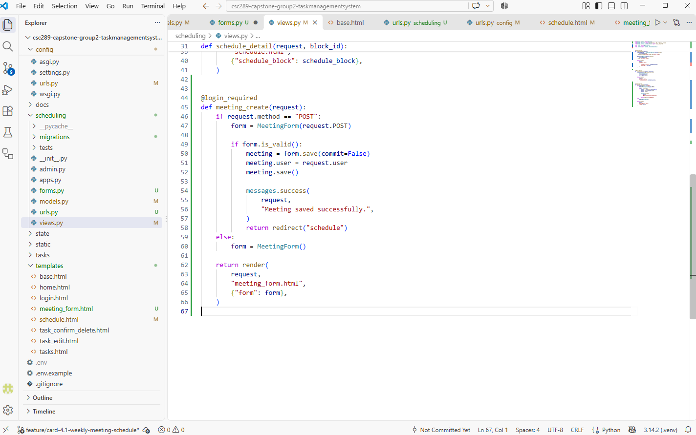
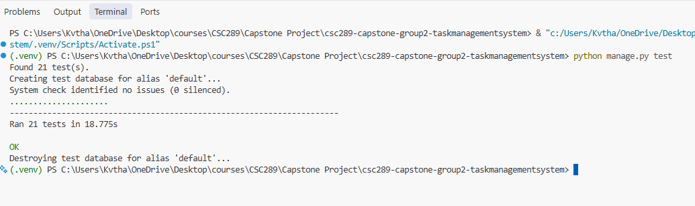
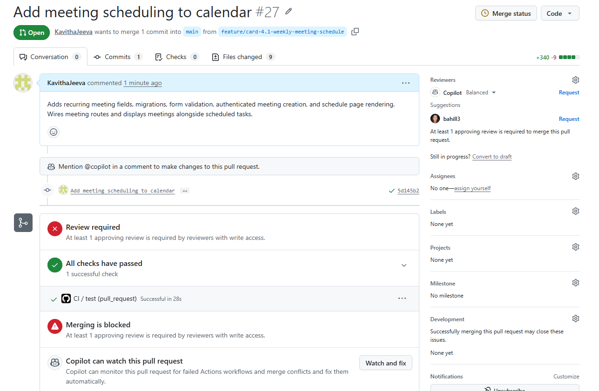

# CSC289 Programming Capstone
## Sprint #4 Status Update 1

**Project Name:** Task Management System  
**Team Number:** Group 2  
**Team Lead/Scrum Master:** Bethany Arielle Hill  
**Sprint:** Sprint 4  
**Status Update:** 1

### 1. Tasks Assigned

My assigned task is:

**Card 4.1 – Input and Save the Weekly Meeting Schedule (UR1)**
## Trello Card:

### Week 1 Evidence

**1. Code Implementation**

**2. Automated Tests – Passing**

**3. Continuous Integration (CI) – Passed**

The goal is to allow users to enter and save their weekly meeting schedules under their own accounts.

### 2. Work Completed

During Week 1, I worked on the basic meeting schedule functionality.

- Defined the Meeting model with the required meeting information and user relationship.
- Created the database migration.
- Built the meeting form and view for entering meetings manually.
- Implemented the ability to save meetings under the logged-in user's account.
- Worked on displaying saved meetings on the schedule page.

### 3. Current Status

**Status: In Progress.**

The basic meeting entry and saving functionality has been implemented, and saved meetings are appearing on the schedule page. The remaining work includes further verification and testing.

### 4. Remaining Work

I plan to complete the following tasks during Week 2:

- Finish verifying the weekly schedule display.
- Write tests to confirm meetings can be saved and loaded correctly.
- Verify that users can access only their own meetings.
- Run the relevant tests and resolve any failures.
- Confirm that the Definition of Done is satisfied.

### 5. Challenges

I needed to troubleshoot the meeting form and schedule templates to ensure that the form fields and saved meeting information displayed correctly. I worked through these issues and was able to display saved meeting information on the schedule page.

### 6. Plan for the Next Week

Next week, I will focus on completing the remaining functionality, writing and running tests, and verifying that the feature meets the acceptance criteria.

### 7. Summary

I made progress on Card 4.1 by implementing the basic meeting model, form, saving functionality, and schedule display. I plan to complete the remaining testing and verification during Week 2 before marking the task as Done.