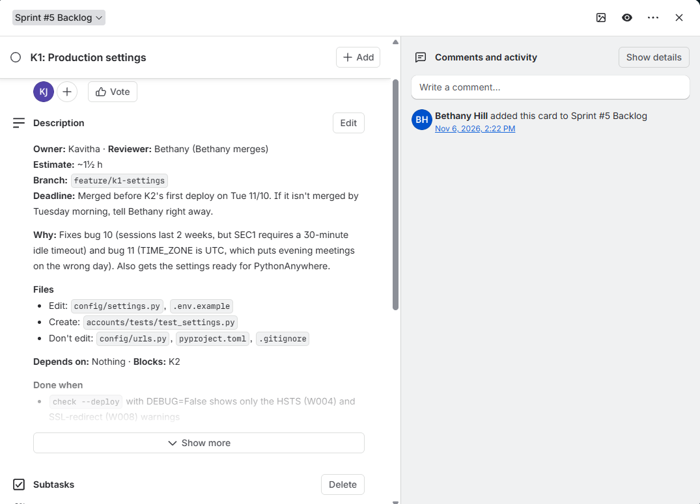
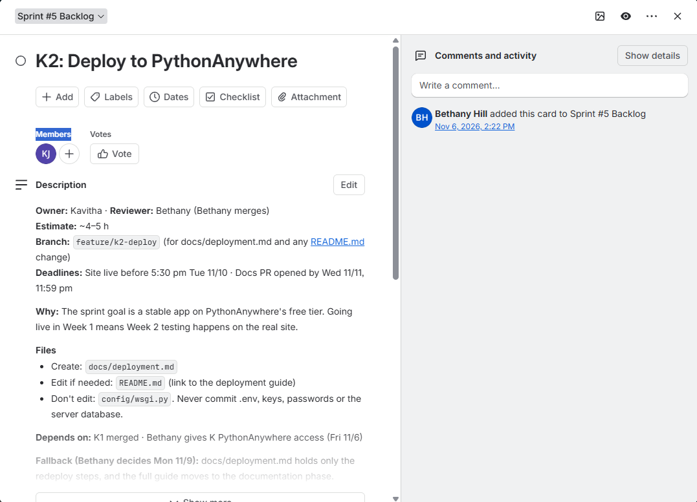
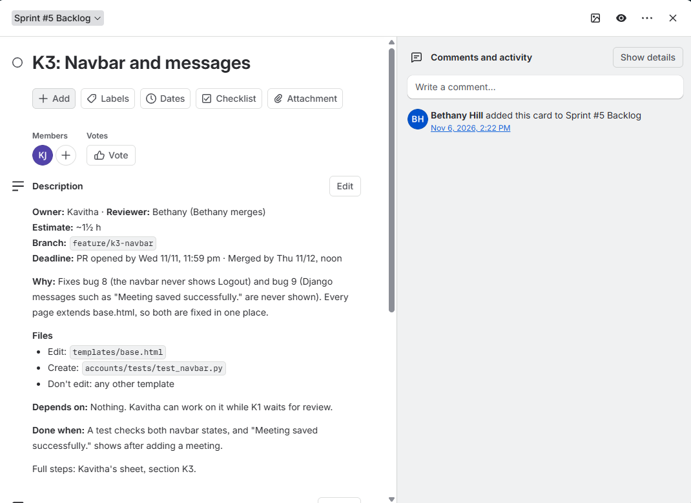

# CSC289 Programming Capstone
# Sprint 5 Backlog

**Project Name:** Task Management System  
**Team Number:** Group 2  
**Team Lead/Scrum Master:** Bethany Arielle Hill  
**Sprint:** Sprint 5

## Sprint Goal

Our goal for Sprint 5 is to prepare the Task Management System for deployment and improve the application. We will update the settings, deploy the project to PythonAnywhere, and improve the navigation bar and messages.

## TRELLO Sprint 5 Backlog Board

The screenshots below show our Sprint 5 backlog in Trello, including the tasks planned for this sprint.

## Sprint Backlog

### Card K1 – Settings Configuration

For this task, I updated the Django settings to prepare the application for deployment. I configured the environment variables, added the CSRF settings, and set up the static files location. I also changed the session timeout to 30 minutes, updated the time zone, and enabled secure cookies when DEBUG is turned off. I removed the unused email setting and updated the `.env.example` file. I also added tests to check the settings.

**Expected Outcome:** All tests pass, and the deployment check shows only the expected W004 and W008 warnings.

**Progress:** The coding and testing are complete. PR #37 is open and waiting for Bethany's review and approval.

### Card K2 – PythonAnywhere Deployment

For this task, I will deploy our application to PythonAnywhere so the team can access it online. I will set up the project, install the required packages, configure the environment variables, and connect the database. I will also collect the static files and configure the web application.

After deployment, I will test the login page, admin page, tasks, and meeting features. I will share the live website link with the team and write simple instructions for future deployment updates.

**Expected Outcome:** The application is live on PythonAnywhere, and the main features work correctly.

### Card K3 – Navbar and Messages

For this task, I will improve the navigation bar and messages. When a user logs in, the navbar should show Tasks, Schedule, their email, and Logout. When a user is logged out, it should show only Login. I will also update the success and error messages so they display clearly using Bootstrap alerts.

I will add tests for the navbar and meeting messages. I will also check the changes manually and take screenshots for the pull request.

**Expected Outcome:** The navbar displays the correct options, and success and error messages work properly.

## Week 1 Plan

During Week 1, I will follow up with Bethany about reviewing and merging K1. After that, I can start the PythonAnywhere deployment. I will also begin K3 by updating the navbar and messages and testing the changes.

## Week 2 Plan

During Week 2, I will finish the deployment and test the live application. I will check the login, tasks, meetings, and admin page. I will also finish the deployment instructions, complete the K3 tests, take screenshots, and open the pull requests for review.

## Definition of Done

Sprint 5 will be complete when K1 is merged, the application is running on PythonAnywhere, and the main features work correctly. The navbar and messages should also work as expected. All required tests should pass, the deployment instructions should be ready, and the pull requests should be reviewed and merged.

## Progress Tracking

K2 depends on K1 being merged and PythonAnywhere access being available. K3 can be started while waiting for K1. Each task will be marked as Done after the work, testing, and review are completed and the pull request is merged.