# CSC289 Programming Capstone
## Sprint 5 Status Update 1

**Project Name:** Task Management System  
**Team Number:** Group 2  
**Team Lead/Scrum Master:** Bethany Arielle Hill  
**Sprint:** Sprint 5  
**Status Update:** 1

### 1. Tasks Assigned

My assigned tasks for Sprint 5 are K1 – Settings Configuration, K2 – PythonAnywhere Deployment, and K3 – Navbar and Messages.

### Sprint 5 Trello Board and Evidence

The screenshots below show my Sprint 5 tasks, completed work, test results, and pull request progress.

**1. Sprint 5 Trello Board**

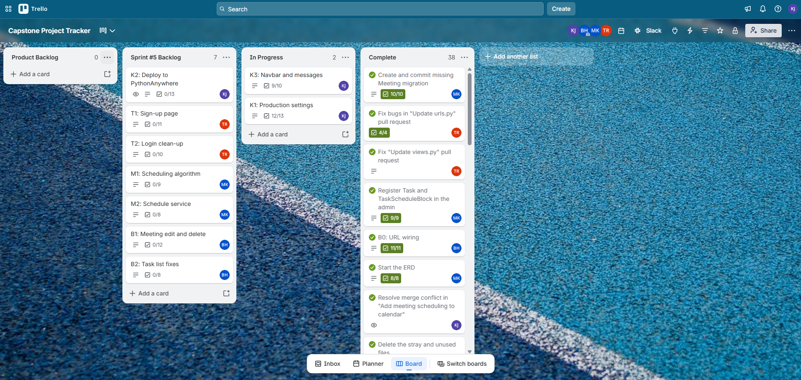

**2. K1 – Settings Configuration**

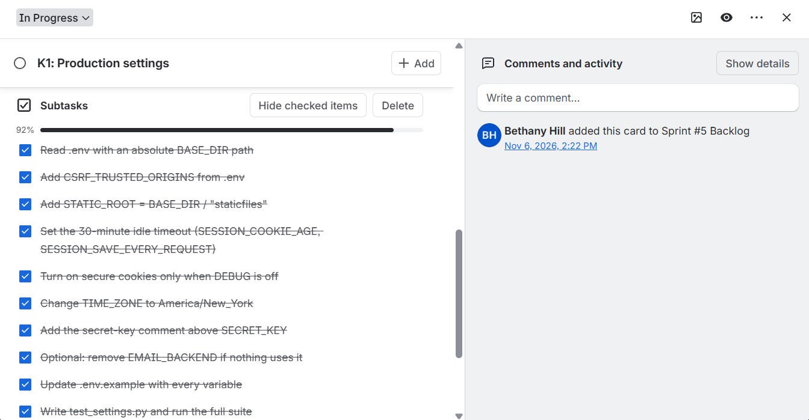

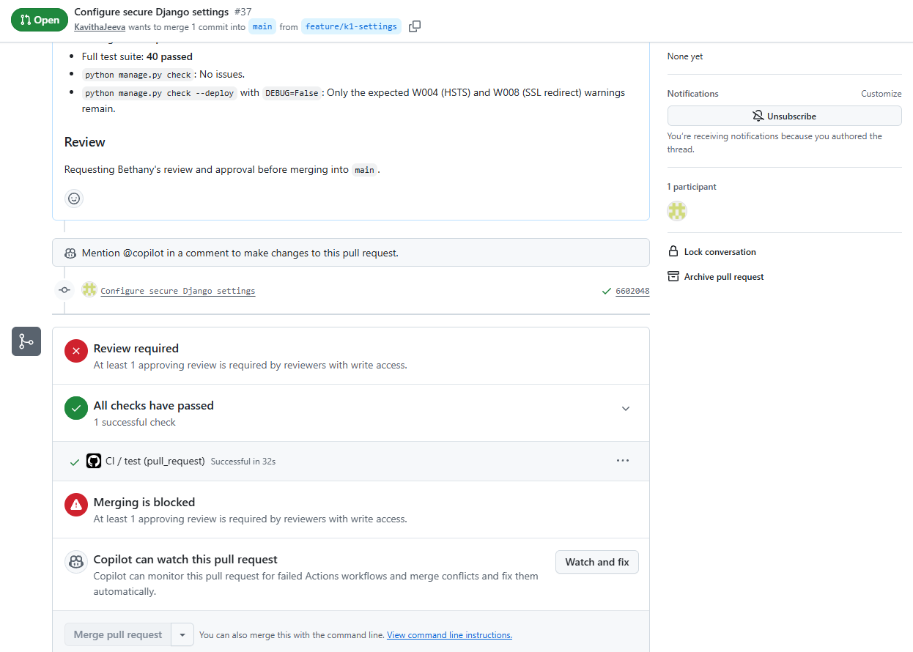

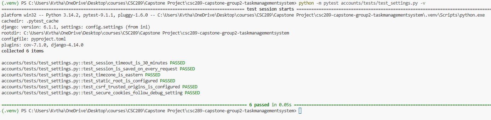

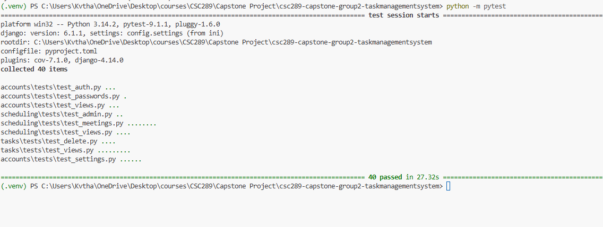

**3. K3 – Navbar and Messages**

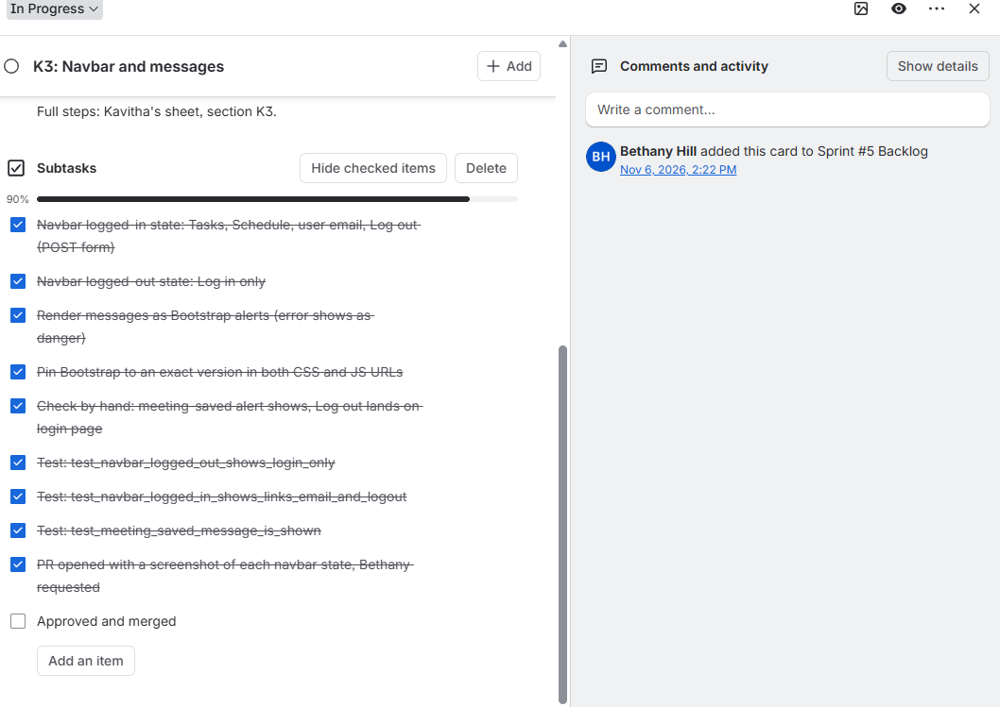

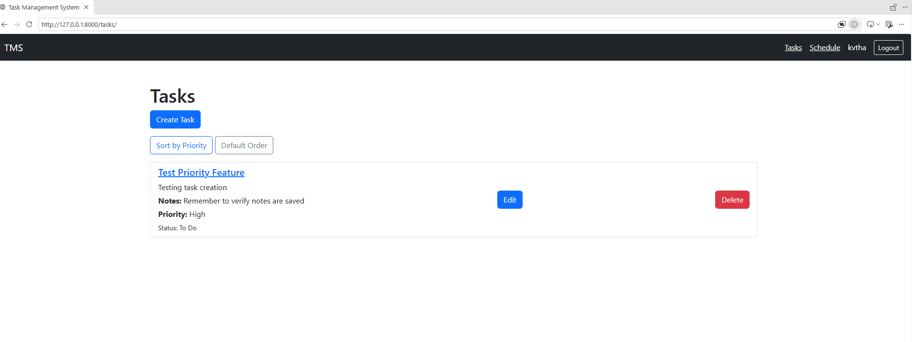

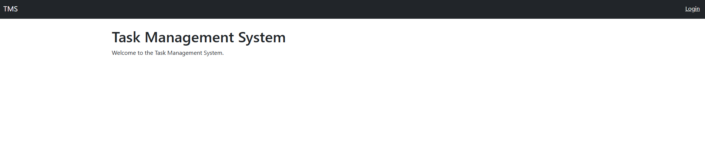

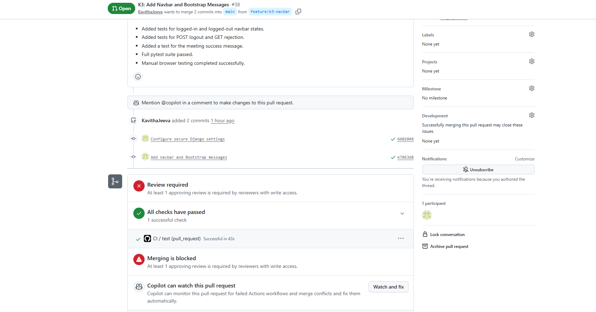

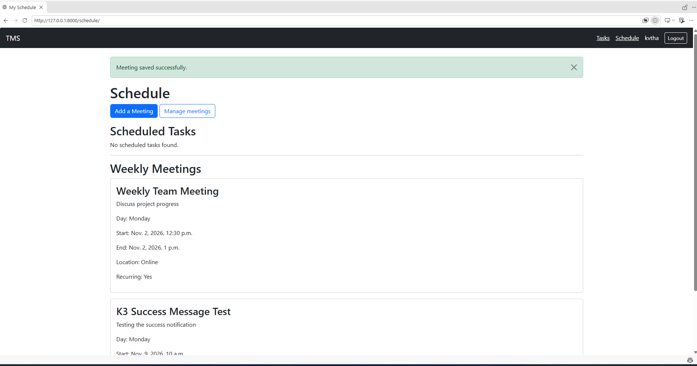

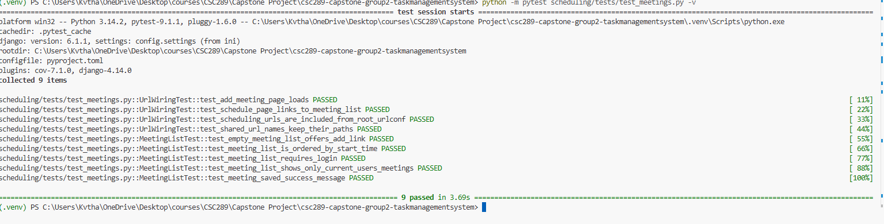
### 2. Work Completed

I completed the development work for K1 by updating the Django settings to use environment variables and adding secure cookie settings. I also added tests to check the configuration.

I completed K3 by updating the navbar based on login status, adding POST-based logout, and displaying Bootstrap success and error messages.

### 3. Testing and Evidence

I ran the tests for both tasks, and all tests passed. I also manually checked the navbar, logout, meeting success message, and login error message. The GitHub Actions CI checks passed successfully.

### 4. Pull Request Status

K1 is submitted as PR #37, and K3 is submitted as PR #38. Both passed their CI checks and are waiting for reviewer approval.

### 5. Current Status

K1 and K3 development and testing are complete. K2 deployment has not started because it depends on K1 being merged and deployment access being available.

### 6. Challenges

I had to fix a few issues with the navbar, logout, and duplicate login error messages. I tested the changes and confirmed they are working correctly.

### 7. Plan for Week 2

I will follow up on the pending pull requests and start K2 deployment once K1 is merged and access is available. I will also test the application after deployment.

### 8. Summary

During Week 1, I completed K1 and K3 and submitted both for review. All tests and CI checks passed. In Week 2, I plan to focus on deployment and any feedback from the reviewer.