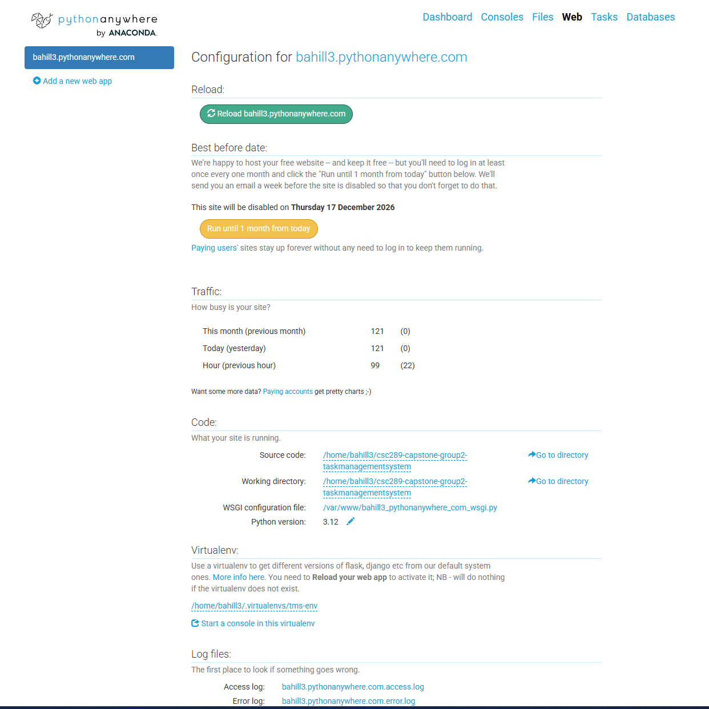
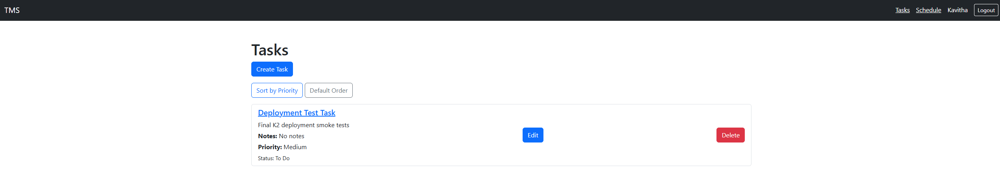
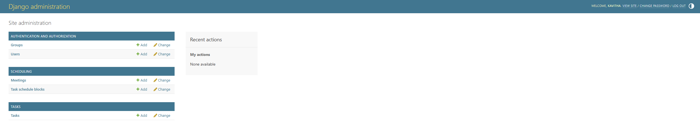

# CSC289 Programming Capstone
## Sprint #5 Status Update 2

**Project Name:** Task Management System  
**Team Number:** Group 2  
**Team Lead/Scrum Master:** Bethany Arielle Hill  
**Team Member:** Kavitha Jeeva  

### TRELLO BOARD

### Tasks Scheduled for This Week

This week, I planned to complete K2 – Deploy to PythonAnywhere. My goal was to make the application live, test its main features, and prepare deployment documentation.

### Tasks Completed This Week – Kavitha Jeeva

I successfully deployed the Task Management System to PythonAnywhere. I configured the production environment, installed the project requirements, applied database migrations, and collected static files. I also configured the WSGI file and HTTPS.

The website is now live at https://bahill3.pythonanywhere.com/. I created a new superuser account and tested login, task creation, weekly meeting creation, and Django Admin. I also created `docs/deployment.md` and opened PR #51. The CI check passed, and the PR is waiting for review and approval.

### Problems, Challenges, and Roadblocks

One challenge was setting up the production environment and making sure the application worked correctly on PythonAnywhere. The local database users were not available on the server, so I created a new superuser account. I also checked the WSGI and static file settings to resolve deployment issues.

### Testing and Verification

I tested the live application and confirmed that login, task creation, weekly meeting creation, and Django Admin were working correctly. I also checked that the website loaded using HTTPS and that the admin CSS displayed correctly. The CI check for PR #51 passed.

### EVIDENCE AND SCREENSHOTS

**Screenshot 1 – K2 Trello Card**

**Screenshot 2 – PythonAnywhere Web App Configuration**

**Screenshot 3 – Live Task Management System**

**Screenshot 4 – Successful Login and Task Creation**

**Screenshot 5 – Weekly Meeting Schedule**

**Screenshot 6 – Django Admin Page**

**Screenshot 7 – Deployment Guide and PR #51**

### SUMMARY

This week, I completed the K2 deployment task and successfully made the Task Management System available on PythonAnywhere. I tested the main features and prepared the deployment guide. PR #51 passed CI and is waiting for review. This work helped me gain more experience with Django deployment, server configuration, and testing a live application.